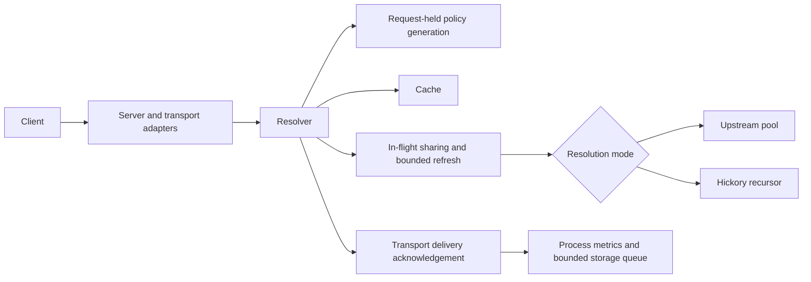

# Architecture

[Home](../README.md) · [Deployment](deployment.md) · [Configuration](configuration.md) · [Operations](operations.md) · [Development](development.md) · [Architecture](architecture.md)

PariNS is a modular Rust DNS service. Its embedded React console and management API run inside the same process that owns DNS, while a separate fixed-purpose root binary performs privileged updates on Linux. Production needs no Node.js server.

## Request path

`server` owns listeners, per-listener supervisors, and shutdown. Plain transports handle UDP packet info and TCP framing, while encrypted adapters share admission through `ingress`. `protocol` and `ecs` validate and normalize each query at their boundaries.

`resolver` pins the cache and policy owners for the lifetime of one request. It evaluates query filtering, checks the cache, shares eligible misses through `flight`, and runs one source lookup under one deadline. Forwarding and recursive modes share this outer path. `upstreams` owns endpoint scheduling and verified transport connections. `recursion` owns the pinned Hickory recursor, DNSSEC result mapping, infrastructure caches, and global outbound limits.

The cache stores upstream answers before response filtering. Response filtering, per-client ECS echoing, and AD bit handling run before transport delivery. Each foreground caller owns its stale fallback decision. Transports confirm delivery only after a write succeeds, and dropping an unconfirmed delivery records a cancellation. Cache code performs no network IO.

An uncacheable answer can still supersede older overlapping cache entries. This covers complete, transaction-independent answers with zero TTL or Extended DNS Errors that disqualify replay. The cache verifies its epoch under the shard lock before learning ECS sharing or admitting an entry. Capacity diagnostics read bounded occupancy and eviction counters without scanning or touching entries, and resident occupancy includes entries past their fresh lifetime.

### Upstream transport

DoH sends GET when the encoded query fits in the client URI and POST otherwise. Both HTTP/2 and HTTP/3 subtract HTTP `Age` from answer TTLs before returning the DNS message. HTTP/3 falls back to verified HTTP/2 only before sending the query. After the `HEADERS` frame writes, the attempt uses the remaining resolver deadline and follows normal upstream failure handling. Hostname pools advance to the next bootstrap address only after an unsent attempt. DoT's single retry on a closed reused pool connection is documented in [Configuration](configuration.md#upstreams).

HTTP/3 pre-send and connection failures trigger an endpoint cooldown starting at 2 seconds and doubling up to 30 seconds. A stream failure on an open connection leaves the cooldown unchanged, and a replaced connection cannot alter its successor's cooldown. A successful HTTP/3 answer resets the cooldown. A definitive HTTP 4xx response other than 408, 414, 421, 425, 429, or 431 disables HTTP/3 until pool replacement.

In recursive mode, every authoritative query acquires a global rate token and concurrency permit before its per-server timeout starts. The recursor keeps bounded delegation, name server, and DNSSEC key caches, while the resolver's cache remains the answer cache for both modes.

## State ownership and lifetime

| State | Owner | Lifetime or change boundary |
| --- | --- | --- |
| Saved configuration revision | Management Store and Manager | Increments on each committed save or rollback and rejects stale writes. |
| DNS generation | Manager and Server | Listener, Resolver, and upstream lifecycle. Health reports carry this generation. |
| Cache instance | Resolver cache generation | Replaced independently on cache behavior edits while older in-flight work keeps its instance. |
| Cache epoch | Cache | Invalidation fences admission from older work within the same cache instance. |
| Cache invalidation token | Cache | Opaque pair of cache instance identity and epoch so old tokens cannot clear a replacement instance. |
| Policy generation | PolicyHandle and subscription service | Immutable snapshot pinned per request, keeping at most one previous generation alive. |
| Metrics, log queue, SQLite, and health | RuntimeServices | Shared across DNS generations for the process lifetime. |
| Log, totals, and history epochs | Storage worker | Independent durable clear and reset boundaries. |
| Sessions and management transport | Active runtime | Process-owned. Credential or transport-realm changes revoke matching sessions. |

One dedicated worker owns the WAL SQLite database. DNS tasks enqueue bounded structured log entries without waiting on disk IO or serialization. Status endpoints read cached storage snapshots instead of querying disk on the hot path. Per-request query logs remain opt-in and budgeted separately from aggregate metrics.

The filter subscription catalog is the durable selection authority. Validators bind the final URL, request representation, and accepted content. The worker persists source objects before selecting them and never rebuilds a missing or corrupt catalog by scanning object files. If a directory sync after a rename is uncertain, PariNS keeps both catalog versions and pauses garbage collection until reconciliation. Background refreshes recheck saved configuration, selected content, local rules, and update freeze state before publishing. Configuration apply persists configuration before swapping policy, while background refresh commits catalog selection before publishing the aggregate rule set.

Management observation holds no configuration or credential authority. `Manager` publishes committed lifecycle metadata and weak `Resolver` references behind a short read lock so status, statistics, and query-log reads never block on the configuration mutex. Metrics, health, listeners, cache, and storage are queried from their respective owners. Status combines those reads without promising one global atomic counter snapshot, cannot keep a stopped `Resolver` alive, and cannot authorize mutations. `lifecycle_phase` separates stable running or stopped states from starting and stopping transitions. Status readiness also requires a stable matching generation, so a generation mismatch signals handover rather than a crashed task. Each status render pins one cache instance.

## Configuration transactions

The console holds one in-memory draft while Rust owns parsing, preview, validation, and persistence. Every save submits the saved revision for optimistic concurrency. One mutation permit serializes accepted changes, and accepted transactions outlive their originating HTTP connection. When a network error hides the response, the console reads server state to confirm what happened rather than replaying the write.

An accepted transaction acquires `Manager` briefly to copy preparation inputs, releases it while loading files and building the candidate, and reacquires it to commit. The mutation permit stays held across all three steps. Commit rechecks the saved revision and verifies that a hot-update target is still running. Failed preparation publishes no state.

`ChangeImpact` classifies every edit as updates-only, hot with optional cache replacement, or restart. Validation and apply share this exact classification, and a stopped or exited runtime cannot accept a hot update.

Updates-only changes preserve both running and stopped DNS states. Supported cache, storage, statistics, and filtering edits keep listeners running and replace only changed components. Candidate inputs are prepared before stopping DNS. Restart changes stop the previous generation, bind every candidate listener, persist the new configuration, and start the new generation. On failure, PariNS attempts to restore the saved configuration. Startup and recovery may run degraded while individual listeners retry, whereas a newly applied configuration must bind every listener before persistence.

Read-only observation, session validation, and saved-configuration reads stay responsive during preparation and persistence. The observed configuration revision advances only after commit. Credentials, session checks, and update freeze keep their existing owners, while persistence and runtime replacement stay serialized under `Manager`.

## Startup and terminal shutdown

File mode loads TOML directly and owns its own subscription scheduler. Managed mode takes ownership of an already bound management socket without releasing its port, opens the private `Store` and `RuntimeServices`, and launches the saved DNS configuration alongside process-owned subscription, startup-retry, and update-check schedulers.

A clean cache snapshot is durably consumed before DNS starts serving and loads only if its configuration and policy fingerprint matches. Only the terminal shutdown owner writes a new clean snapshot after DNS and background tasks reach quiescence. Apply and rollback never write snapshots. Cache saving and storage draining run concurrently under separate time budgets, and the runtime directory lock stays held until both complete.

During listener shutdown, only streams carrying a complete DNS query can trigger a forced stop, meaning end-of-stream for DoH or FIN for DoQ. Incomplete queries and unfinished handshakes cancel immediately. Peer close notification uses at most half of `shutdown_grace_ms`. Outside a generation stop, an exiting listener drains independently while its supervisor rebinds it and the shared resolver and upstream pool stay online.

TCP admission pauses briefly on descriptor or buffer exhaustion, and errors on a single pending connection never stop the listener. QUIC admission replies to unvalidated client addresses with a stateless Retry before allocating a connection slot or source budget.

## Updates and security boundaries

The management API enforces `Host` and `Origin` checks plus an `HttpOnly` session cookie paired with an in-memory session binding. The browser never persists that binding, credentials, or drafts. Live query-log WebSockets have their own admission limits, authentication handshake, and shutdown owner.

`/api/query-log/live` checks `Origin` and the session cookie before upgrade, then expects the in-memory binding in the first message. Authentication failures close with `4401`, session revocation or expiry closes with `4403`, idle timeout closes with `4408`, and management shutdown closes with `1001`. The storage worker executes polls, and every accepted filter change emits a `subscribed` acknowledgement before streaming records. Spontaneous `state` updates never acknowledge a subscription change.

Sign-in attempt budgets key by socket peer, grouping IPv6 peers by `/64` and mapping IPv4-mapped peers to IPv4. Password hashing uses a separate global concurrency permit, and a cancelled caller's blocking hash keeps its permit until hashing completes. Credential changes leave the saved configuration revision unchanged and revoke all sessions on commit.

Changing the management origin navigates the browser to the new console document and revokes existing sessions. Same-site and cross-site requests may enter only through top-level `GET /` document navigation with `Sec-Fetch-Mode: navigate` and `Sec-Fetch-Dest: document` after `Host` and `Origin` checks. API, asset, and embedded subresource requests require same-origin access.

The update coordinator persists update intent and uses the mutation permit to hold the update freeze. The root updater accepts only fixed operations against fixed installation paths, and its journal is the installed-identity authority. It owns no DNS logic, configuration, or runtime databases, and never executes a candidate binary as root. Changing this helper contract requires explicit release and installer compatibility handling.

A matching terminal fence and installed identity resolve outstanding commit intent. Stage refusals record under their operation ID and phase nonce even before an operation begins, so the application reconciles without replaying Stage. A matching Commit that fails pre-installation checks records failure before returning. Boot rollback publishes the restored launch for readiness verification. A `manual_required` operation remains open until a full reinstallation proves readiness, and the journal retains its terminal fences across registration.
