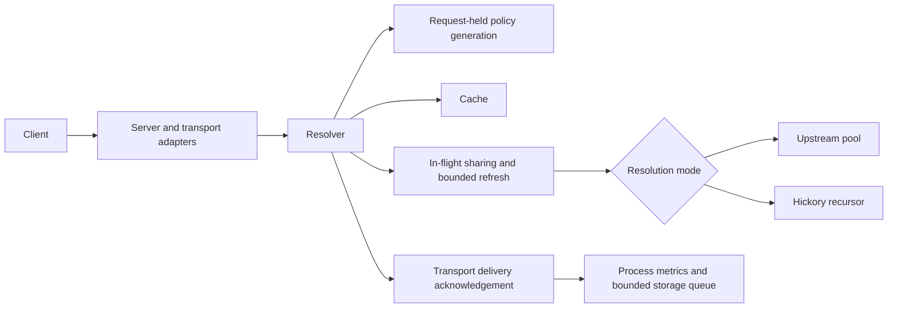
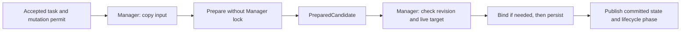

# Architecture

[Development](development.md) · [Configuration](configuration.md) · [Operations](operations.md)

PariNS is a modular Rust service. Its embedded React console and management API
control the same process that owns DNS, while a separate fixed-purpose updater
performs privileged installation work on Linux. Production needs no Node server.

## Request path

`server` owns listeners, their supervisors and shutdown. Plain transports handle
UDP packet information and TCP framing; encrypted adapters share admission through
`ingress`. `protocol` and `ecs` validate and normalize the request at their owning
boundaries.

`resolver` captures the cache and policy owners for each request. It applies query
filtering, looks up the cache, shares eligible misses through `flight`, and runs
one source operation with one deadline. Forwarding and recursive modes share this
outer behavior. `upstreams` owns endpoint scheduling and verified transport
connections. `recursion` owns the pinned Hickory recursor, DNSSEC result mapping,
infrastructure caches and global outbound bounds.

The cache keeps upstream answers before response filtering. Filtering, per-client
ECS and AD handling run before delivery. Stale fallback belongs to each foreground
consumer. A transport confirms delivery only after its write succeeds; dropping an
unconfirmed delivery records cancellation. Cache code performs no network IO.

## State ownership and lifetime

| State | Owner | Lifetime or change boundary |
| --- | --- | --- |
| Saved configuration revision | Management Store and Manager | Each committed configuration save or rollback; rejects stale writes. |
| DNS generation | Manager/Running and Server | Listener, Resolver and upstream lifecycle; health publications carry this generation. |
| Cache instance | Resolver's cache generation | Replaced independently for cache behavior changes; old work retains its own instance. |
| Cache epoch | Cache | Invalidation fences admission by older work inside that instance. |
| Cache invalidation token | Cache | Opaque instance identity plus epoch; old tokens cannot clear a replacement instance. |
| Policy generation | PolicyHandle and subscription service | Immutable publication; each request pins its rules, with at most one retained old generation. |
| Metrics, log queue, SQLite and health | RuntimeServices | Shared across DNS generations in the process. |
| Log, totals and history epochs | Storage worker | Independent durable clear/reset boundaries. |
| Sessions and management transport | Active | Process-owned; credential or transport-realm changes revoke the appropriate sessions. |

SQLite has one worker that owns the WAL database. DNS producers enqueue bounded
structured entries without waiting for disk or serialization. Status reads use
cached storage observations. Per-request logs are opt-in and bounded separately
from aggregate metrics.

Management observation has no configuration or credential authority. Manager
publishes committed lifecycle metadata and weak Resolver references to a short
read lock; status, statistics and query-log reads do not acquire the configuration
mutex. Metrics, health, listeners, cache and storage are read from their owners.
Status combines these observations rather than promising one atomic snapshot of
all counters. It cannot keep a stopped Resolver alive or authorize a mutation.
`lifecycle_phase` distinguishes stable state from starting and stopping. Status
readiness additionally requires a stable matching generation; runtime readiness
and history retain their existing health owner. A generation mismatch means a
handover, not proof that a task exited. One status render pins one cache instance.

## Configuration transactions

The console keeps one in-memory draft. Rust owns parsing, preview, validation and
the persisted configuration. A save carries the saved revision. The existing
mutation permit serializes accepted changes; accepted transactions outlive their
initiating HTTP connection. Network uncertainty is confirmed through reads rather
than replaying a mutation.

The task takes a short Manager lock to copy preparation input, releases it while
reading material and building the candidate, and reacquires it to commit. The
mutation permit remains held throughout. Commit rechecks the saved revision and
the live hot-update target; failed preparation publishes no candidate state.

`ChangeImpact` names updates-only, hot (with explicit cache replacement), and
restart changes. Validation and application use the same source-document
classification; a stopped or exited runtime cannot receive a hot change.

Updates-only changes preserve a stopped or running DNS service. Supported cache,
storage, statistics and filtering changes preserve listeners, replacing only the
state whose behavior changed. Candidate material is prepared before stopping DNS.
Changes requiring a restart then stop the old generation, bind every candidate
listener, persist the configuration, and start the new generation. Failure attempts
to restore the saved configuration. Startup and
recovery may serve degraded while individual listeners retry; a newly applied
candidate must bind every listener before persistence.

Read-only observation remains available during preparation and persistence. Its
configuration revision advances only after the transaction commits. Credentials,
session checks and update freeze keep their existing owners. Session and saved
configuration reads remain available during candidate preparation; persistence
and runtime replacement remain serialized by Manager.

## Startup and terminal shutdown

File mode loads TOML directly and owns its subscription scheduler. The managed
entry point takes ownership of a bound socket without releasing its address,
opens the private Store and RuntimeServices, and starts the
saved DNS configuration; process-owned schedulers manage subscriptions, startup
retry and software checks.

A clean cache snapshot is durably consumed before serving. Its contents are
restored only when the configuration and policy fingerprint matches. Only the
terminal shutdown owner may publish another clean snapshot, after DNS and
background work are quiescent. Configuration apply and rollback do not save one.
Cache save and storage flush have separate bounded budgets; storage releases its
directory lock only after the save boundary.

## Updates and security boundaries

The authenticated management API applies Host/Origin checks and an HttpOnly Cookie
plus an in-memory session binding. The browser never persists that binding,
credentials or configuration drafts. Live-log sockets have their own admission,
authentication, resource limits and shutdown owner.

The application update coordinator persists intent and uses the existing mutation
permit for the update freeze. The root updater accepts only fixed operations and
fixed installation paths; its journal is the installed-identity authority. It
does not own DNS, configuration or runtime databases and never executes a
candidate as root. Changes to this helper contract require separate release and
installation compatibility decisions.
